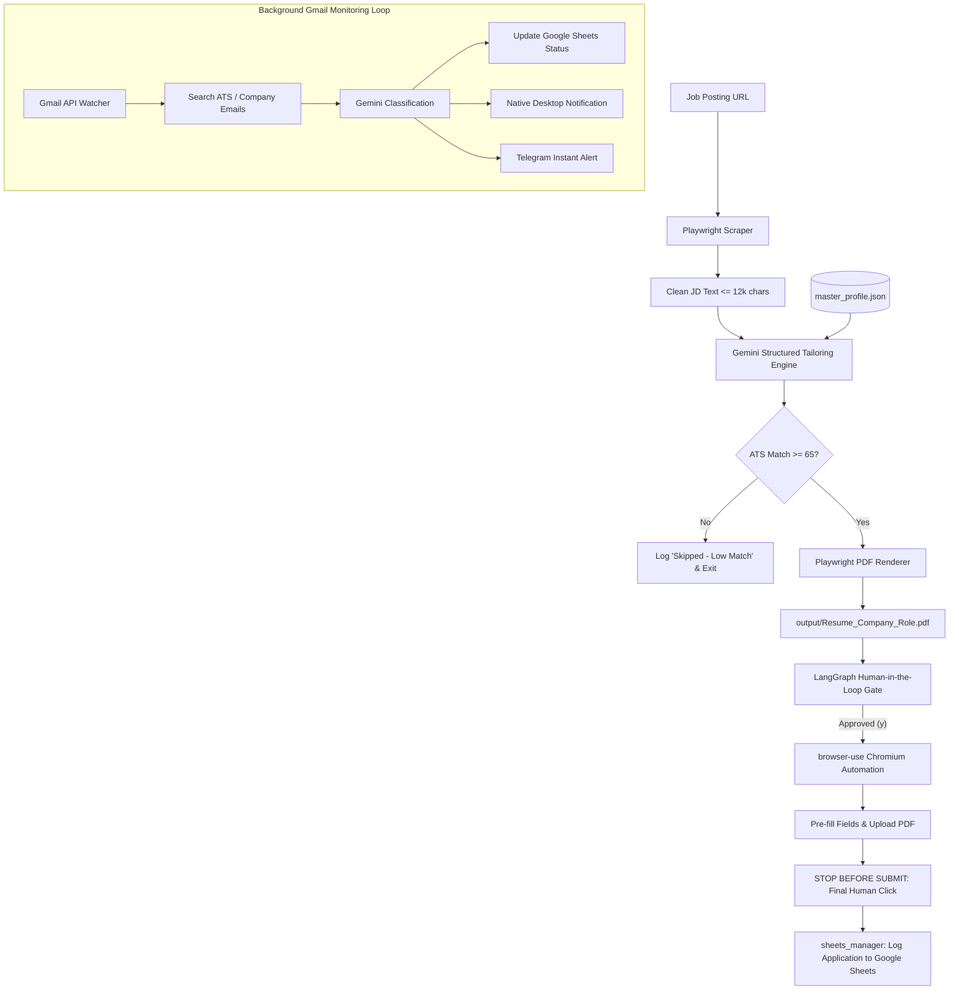

# Autonomous Real-Time Job Application & Recruitment Tracking Agent

A complete, production-grade, zero-cost (free-tier) automated system built with **Python 3.12**, **Google Gemini API**, **LangGraph**, **Playwright**, **Browser-Use**, **Google Sheets**, and **Gmail API**.

---

## Key System Capabilities

1. **Intelligent JD Scraping:** Asynchronously extracts clean, structured job posting content with headless Playwright (capped at 12,000 characters to conserve LLM context).
2. **Strict Zero-Fabrication Resume Tailoring:** Leverages Google Gemini with Pydantic structured output (`json_schema`). It **never** invents companies, dates, metrics, or skills—only mirrors genuine qualifications from `master_profile.json`, re-ranks bullet points, computes an objective ATS match score (0–100), and flags missing requirements.
3. **ATS-Compliant PDF Generation:** Automatically renders a clean, single-column HTML/CSS resume template via Playwright `page.pdf()`, avoiding parsing errors associated with multi-column formats.
4. **Human-in-the-Loop Safeguard (`LangGraph`):** Halts with `interrupt()` to present the match score, missing skills, and PDF path for explicit review.
5. **Browser Form Auto-Fill:** Launches `browser-use` on Chromium/Chrome to pre-populate application fields and upload the tailored PDF, **stopping right before clicking the final Submit button**.
6. **Unified Google Sheets Tracker:** Automatically initializes schema and records every applied position (`Application ID`, `Date Applied`, `Company`, `Role`, `Match Score`, `Missing Skills`, `Status`, `Gmail Thread Link`).
7. **Gmail Status Watcher & Instant Alerts:** Continuously monitors your inbox for recruitment communications (from companies and major ATS domains: Greenhouse, Lever, Workday, Ashby, SmartRecruiters, LinkedIn), categorizes updates using Gemini structured classification, updates Google Sheets, and dispatches native desktop and Telegram notifications.

---

## Architecture Flow



---

## Directory Structure

```
├── .env.example              # Template for API keys and configurations
├── requirements.txt          # Python dependencies
├── master_profile.json       # Candidate source of truth (zero fabrication)
├── resume_template.html      # ATS-friendly single-column HTML/CSS template
├── sheets_manager.py         # Google Sheets OAuth2 client & CSV fallback
├── autopilot.py              # 100% Fully Autonomous Master Engine (Batch & Single)
├── jobs.txt                  # Batch job URLs queue for hands-off processing
├── apply_agent.py            # LangGraph application & browser-use agent
├── cold_email_agent.py       # Recruiter discovery & cold email outreach agent
├── email_tracker.py          # Gmail inbox watcher & notification dispatcher
├── scheduler.py              # Cloud runner daemon & web dashboard API
├── Dockerfile                # Multi-platform container configuration
├── render.yaml               # Render free-tier deployment configuration
├── railway.json              # Railway deployment configuration
├── README.md                 # Detailed deployment and usage guide
├── output/                   # Directory where tailored PDFs are generated
└── applications_tracker.csv  # Local offline tracker (when Google Sheets offline)
```

---

## Setup & Prerequisites

### 1. Python Environment

Clone or navigate to the project directory:

```bash
# Recommended Python version: 3.12+
python -m venv .venv

# Activate virtual environment
# Windows:
.\.venv\Scripts\activate
# Linux/macOS:
source .venv/bin/activate

# Install dependencies
pip install -r requirements.txt

# Install Playwright browser binaries
playwright install chromium
```

---

### 2. Google AI Studio (Free Gemini API Key)

1. Navigate to [Google AI Studio](https://aistudio.google.com/).
2. Click **Get API key** and generate a free API key.
3. Add it to your `.env` file:
   ```env
   GOOGLE_API_KEY=AIzaSy...
   ```

---

### 3. Google Cloud Setup (Google Sheets & Gmail)

1. Open the [Google Cloud Console](https://console.cloud.google.com/).
2. Create a new project (e.g., `Job-Application-Agent`).
3. Enable the required APIs:
   - **Google Sheets API**
   - **Google Drive API**
   - **Gmail API**
4. Configure the **OAuth Consent Screen**:
   - User Type: **External**
   - Fill in App Name and your support email.
   - Under **Scopes**, add:
     - `https://www.googleapis.com/auth/spreadsheets`
     - `https://www.googleapis.com/auth/gmail.readonly`
   - Add your own email as a **Test User**.
5. Create OAuth Credentials:
   - Navigate to **APIs & Services > Credentials**.
   - Click **Create Credentials > OAuth Client ID**.
   - Application Type: **Desktop App**.
   - Download the JSON file, rename it to `credentials.json`, and place it in the project root.
6. Create a blank Google Sheet:
   - Go to [Google Sheets](https://sheets.new) and create a new sheet.
   - Copy the spreadsheet ID from the URL:
     `https://docs.google.com/spreadsheets/d/`**`<YOUR_SPREADSHEET_ID>`**`/edit`
   - Paste it into `.env`:
     ```env
     GOOGLE_SHEET_ID=your_spreadsheet_id_here
     ```

> **Note on Offline Mode:** If `credentials.json` or `GOOGLE_SHEET_ID` is not configured, both `apply_agent.py` and `email_tracker.py` automatically utilize the local `applications_tracker.csv` so the entire pipeline can be tested immediately without network blockers.

---

### 4. Optional: Telegram Instant Alerts

1. Message `@BotFather` on Telegram to create a bot and copy your `TELEGRAM_BOT_TOKEN`.
2. Message `@userinfobot` or start a chat with your bot to obtain your numeric `TELEGRAM_CHAT_ID`.
3. Add both to your `.env` file:
   ```env
   TELEGRAM_BOT_TOKEN=123456789:ABCdef...
   TELEGRAM_CHAT_ID=987654321
   ```

---

## Usage Guide

### 1. Customizing Your Master Profile
Open `master_profile.json` and replace the placeholder fields with your genuine background:
- **`basics`**: Name, email, phone, location, LinkedIn, GitHub, notice period, compensation expectations, work authorization.
- **`skills`**: Languages, frameworks, databases, cloud, and tools.
- **`experience`**: Verifiable roles, companies, dates, and bullet points.
- **`projects`**: Authentic portfolio projects and tech stacks.

> The LLM tailoring node has strict zero-fabrication guardrails. It selects, highlights, and matches your genuine profile points to the target job description without inventing metrics or roles.

---

### 2. Autopilot: 100% Fully Automated Mode (`autopilot.py`)

Run the entire hiring pipeline hands-off with **one command**. Autopilot automatically scrapes the JD, evaluates ATS alignment, tailors your resume with zero fabrication, renders the PDF, pre-fills the portal form, discovers hiring HR contacts, drafts/sends a customized cold email with the PDF attached, logs to your tracker, and monitors Gmail for replies.

#### A. Apply to a Single Job Automatically:
```bash
python autopilot.py "https://jobs.lever.co/company/job-id"
```

#### B. Batch Queue Automation (Multiple Jobs):
Add job links to `jobs.txt` (one per line) and run:
```bash
python autopilot.py --batch jobs.txt
```

#### C. Continuous 24/7 Autopilot Daemon:
Monitors `jobs.txt` for newly added jobs, processes them automatically, and sweeps Gmail for interview invitations in the background:
```bash
python autopilot.py --daemon --interval 900
```

---

### 3. Interactive Step-by-Step Application (`apply_agent.py`)

Run the agent on any target job URL:
```bash
python apply_agent.py https://jobs.lever.co/example-company/software-engineer
```

Or run an automated test using the built-in sample JD:
```bash
python apply_agent.py --test
```

#### What Happens:
1. Playwright scrapes the JD and cleans the text.
2. Gemini evaluates ATS alignment and tailors your resume.
3. If `match_score < 65`, the system alerts you and terminates cleanly.
4. Playwright renders an ATS-optimized PDF into `output/Resume_<Company>_<Role>.pdf`.
5. The terminal halts for **Human-in-the-Loop Review**:
   ```text
   =================================================================
                HUMAN-IN-THE-LOOP APPROVAL REQUIRED
   =================================================================
   Company:        Horizon AI Solutions
   Role:           Senior AI Automation Engineer
   ATS Match:      88/100
   Missing Skills: Distributed Ray clusters
   Generated PDF:  output/Resume_Horizon_AI_Solutions_Senior_AI_Engineer.pdf
   Application URL:https://...
   =================================================================
   Approve form auto-filling? (y/n):
   ```
6. Upon entering `y`, `browser-use` launches Chromium, loads the application page, fills all fields, and uploads the resume PDF.
7. **The browser pauses before the final Submit button.** You can visually inspect the pre-filled fields and click submit.
8. The job application is logged into your Google Sheet (or `applications_tracker.csv`).

---

### 3. Monitoring Recruitment Emails (`email_tracker.py`)

#### Single Scan:
Check for recent recruiter updates once:
```bash
python email_tracker.py --once
```

#### Continuous Background Watch:
Run a standing monitoring loop (scans every 15 minutes by default):
```bash
python email_tracker.py --watch --interval 900
```

#### Simulated Recruiter Test:
Verify that status updates, sheet synchronization, and desktop notifications work properly without sending live emails:
```bash
python email_tracker.py --mock-test
```

---

### 4. Automated Recruiter Discovery & Cold Email Outreach (`cold_email_agent.py`)

Directly reach out to hiring managers, talent acquisition leads, and recruiters:

```bash
# 1. Preview the generated cold email in your terminal
python cold_email_agent.py --company "Horizon AI Solutions" --role "Senior AI Automation Engineer" --mode preview

# 2. Draft Mode (Recommended): Automatically prepares a draft in your Gmail inbox with tailored PDF attached
python cold_email_agent.py --company "Stripe" --role "Staff Engineer" --url "https://jobs.lever.co/stripe/123" --mode draft

# 3. Direct Send: Sends directly via authenticated Gmail SMTP with rate limiting
python cold_email_agent.py --company "Datadog" --role "AI Engineer" --email "hiring.manager@datadog.com" --mode send
```

#### Features:
- **Intelligent Recruiter Discovery:** Scrapes hiring manager contact info from the job description, leverages Hunter.io free API (if configured), and resolves domain-specific recruiting aliases (`talent@company.com`, `recruiting@company.com`).
- **Strict Zero-Fabrication Tailoring:** Extracts verified metrics and accomplishments from `master_profile.json` and crafts a concise, professional message (<160 words) with a clear 10-minute call CTA.
- **Gmail Draft Integration:** Prepares drafts inside your personal Gmail inbox so you can review and click send with one click.
- **Deliverability Protection:** Automatically limits daily outbound cold emails (`MAX_DAILY_COLD_EMAILS=15`) to preserve sender domain reputation.

---

### 5. Deploying 24/7 on Free Cloud Hosting Platforms

Run the agent in the cloud 24/7 with zero server costs using `scheduler.py` and the provided `Dockerfile`.

#### Option A: Deploy to Render (Free Tier)
1. Push this repository to GitHub.
2. Sign up at [Render.com](https://render.com/).
3. Click **New + > Web Service** and connect your GitHub repository.
4. Render automatically detects `Dockerfile` and `render.yaml`.
5. Under **Environment Variables**, add:
   - `GOOGLE_API_KEY`: Your free Gemini API key.
   - `SMTP_USER` & `SMTP_PASSWORD`: (Optional) Your Gmail and 16-character Google App Password.
   - `TELEGRAM_BOT_TOKEN` & `TELEGRAM_CHAT_ID`: (Optional) For real-time mobile notifications.
6. Click **Deploy Web Service**. Render provides a free URL (e.g. `https://your-agent.onrender.com`).

#### Option B: Deploy to Railway (Free Trial / Hobby)
1. Install the Railway CLI or connect via GitHub on [Railway.app](https://railway.app/).
2. Run `railway up` or import the repository.
3. Railway will build using `railway.json` and `Dockerfile`.
4. Add your `.env` variables under the **Variables** tab.

#### Option C: Run Headless with Docker / Any VPS
```bash
# Build container image
docker build -t job-agent:latest .

# Run container with environment variables
docker run -d --name job-agent \
  -p 8000:8000 \
  -e GOOGLE_API_KEY="your_api_key" \
  -e SMTP_USER="your_email@gmail.com" \
  -e SMTP_PASSWORD="your_app_password" \
  job-agent:latest
```

---

### 6. Cloud Web Dashboard & Webhook APIs

Once deployed in the cloud, the agent exposes a live web dashboard and REST API:

- **Live Dashboard (`GET /`):** View all active job applications, ATS match scores, and current interview/offer statuses in real-time in your browser.
- **Health Check (`GET /health`):** Cloud keep-alive endpoint returning system health and background poller status.
- **Trigger Application via Webhook (`POST /apply`):**
  ```bash
  curl -X POST https://your-agent.onrender.com/apply \
    -H "Content-Type: application/json" \
    -d '{
      "job_url": "https://jobs.lever.co/company/role",
      "send_cold_email": true,
      "cold_email_mode": "draft"
    }'
  ```
- **Trigger Instant Gmail Sweep (`POST /trigger-scan`):** Manually trigger an inbox check on demand.

---

## Google Sheet Schema Reference

The tracker schema includes the following standardized columns:

| Column Header | Description |
|---|---|
| **Application ID** | Unique ID (e.g., `APP-20261113-A1B2C3`) |
| **Date Applied** | Timestamp of application dispatch |
| **Company** | Target company name |
| **Role** | Position title |
| **Job URL** | Link to the application posting |
| **Match Score** | ATS alignment score (0–100) |
| **Missing Skills** | Skills from JD absent in profile |
| **Tailored PDF Path** | Path to the tailored single-column resume |
| **Status** | Current status (e.g., `Applied - Awaiting Response`, `Interview Scheduled`, `Offer`, `Rejected`) |
| **Last Email Update** | 1-sentence summary of latest email update |
| **Last Updated Timestamp** | Timestamp of most recent update |
| **Gmail Thread Link** | Direct link to view the thread in Gmail web |

---

## Free-Tier & Rate Limit Optimization

- **Resume Tailoring:** Uses `gemini-2.5-flash` (or `gemini-3.8-flash` if enabled) with structured JSON schemas for precision.
- **Fast Automation & Classification:** Uses `gemini-2.5-flash` / `gemini-3.5-flash-lite` for multi-step browser interaction and email parsing to maximize the free-tier requests per minute (RPM) and requests per day (RPD).
- **Token Efficiency:** Web scraping caps raw input at 12,000 characters and strips non-content tags (`<nav>`, `<script>`, `<style>`) before sending to the model.
